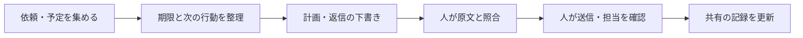

# ChatGPTで「自分の秘書」を作る：優先順位・メール・引き継ぎを支える導入キット

<!-- Qiita投稿用の草稿。タイトルは投稿画面のタイトル欄へ、本文は以下から。候補タグ: ChatGPT, AI, 生成AI, 業務効率化, 初心者。Qiitaには未投稿。 -->

## はじめに

メールを読んで返事をしたつもりでも、二つあった質問の片方にしか答えていなかった。目の前の仕事を進めていたら、別の締切が近づいていた。丁寧に書こうとした返信が、かえって回りくどくなっていた。

こうした場面で使えるように、**優先順位・メールの読解・日本語の推敲・引き継ぎを支える「AI秘書キット」**を作りました。

GitHub: [amu815/ai-secretary-kit](https://github.com/amu815/ai-secretary-kit)

事務の仕事、学生生活、家庭の用事など、自分の担当を整理する場面で使える構成です。最初はプログラミング不要。指示文をコピーして、ChatGPTに渡すところから始められます。

この記事の事例は、使い方を説明するための架空のものです。特定の人物や組織の実例ではありません。

## 何を作ったのか

キットでは、AIに次の流れを手伝ってもらいます。



| 用意したもの | 用途 |
| --- | --- |
| コピーして使う共通指示 | AI秘書の仕事の進め方を決める |
| 場面別プロンプト | 朝の整理、メール読解、文章確認、引き継ぎ |
| 共有タスク表とチェック表 | 担当・期限・確認待ちを見える形にする |
| 4つのskills | 対応環境で手順を繰り返し呼び出す |
| 任意のローカル確認ツール | 確認後に変更された下書きの書き出しを止める |

AIに入力していない依頼や予定は、AIには見えていません。まず必要な情報を集め、何を確認できたかがわかる状態を作ります。

## 1. まずはChatGPT Plusを導入候補にする

継続して使うなら、本稿ではChatGPT Plusを出発点にします。公式の案内では月額20米ドルですが、最終的な請求額や利用上限は契約画面で確認してください。所属先が利用環境を提供している場合は、それを先に確認しましょう。[公式の料金案内](https://learn.chatgpt.com/docs/pricing)

ただし、「課金すれば仕事の問題が解決する」という意味ではありません。仕事の量が多すぎる、期限が決まっていない、誰に相談すればよいかわからない、といった問題には、人による調整も必要です。

そして、**ChatGPT Plusとdotsの利用資格は別**です。2026年10月22日に確認した公式案内では、dotsは対象のPro、Business Premium、Enterpriseへ段階展開されており、Plusは対象一覧にありません。dotsを使う目的で課金する方は、契約前に条件を確認してください。[公式のdots利用条件](https://learn.chatgpt.com/docs/dots#access)

このキットの基本手順に、dotsやAPIキーは不要です。

## 2. 「自分のAI秘書」を作る

ChatGPTで「自分のAI秘書」というプロジェクトを作り、[共通指示](https://github.com/amu815/ai-secretary-kit/blob/main/prompts/secretary-instructions.md)をプロジェクトの指示欄に貼り付けます。Projectsでは、関連する会話や指示、資料をまとめられます。[公式のProjects案内](https://learn.chatgpt.com/docs/projects)

Projectsを使わない場合は、新しいチャットの最初に共通指示を貼り付けても始められます。

共通指示には、たとえば次の内容を入れています。

```text
確認できた事実と推測を分け、不明なことは不明と書く。
優先順位は締切・影響・所要時間・依存関係・使える時間から提案する。
メールの依頼と質問を一つずつ取り出し、原文の根拠を付ける。
日付・金額・約束・承認の有無を勝手に補わない。
返信は下書きとして提示し、実際の送信は私が行う。
```

最初はメール連携を設定せず、[架空の練習データ](https://github.com/amu815/ai-secretary-kit/blob/main/examples/first-day.md)を入力します。指示を保存しただけでは、受信箱の監視や通知は始まりません。

## 3. 優先順位は「締切が近い順」から一歩進める

架空の例として、次の予定を考えます。

| タスク | 締切 | 所要時間 | 注意する点 |
| --- | --- | --- | --- |
| イベントの人数を知らせる | 今日11:30 | 30分 | 会場の席数を決める人が待っている |
| 来月の紹介文を書く | 来月1日 | 90分 | 自分で進められる |
| 見積内容を問い合わせる | 明日15:00 | 45分 | 明日は不在。担当はまだ未定 |
| 提出物を確認する | 「なるべく早く」 | 不明 | 期限と作業内容の確認が必要 |

「今日の締切だけを処理する」では、明日の仕事が止まるかもしれません。だから、不在予定、他の人の待ち時間、担当が決まっているかも渡します。

```text
現在日時と対応できる時間は次のとおりです。
このタスク一覧を、締切・影響・所要時間・依存関係から整理してください。
「まず一つ」「その次」「待ち」「相談が必要」に分け、理由を添えてください。
時間内に収まらない場合は、分担・期限・範囲の調整案を出してください。
不明な締切や担当を勝手に確定しないでください。
```

同時にいくつもの作業を開くことを目標にせず、全体を見たうえで「今やる一つ」を決めます。途中で急ぎの依頼が来たら、残りの予定と合わせて見直します。

共有の仕事では、**「担当候補」と「本人が引き受けた」を分ける**ことも必要です。AIが候補を挙げても、相手の合意までは取れていません。共有表には引受の返事と時刻を残します。

## 4. メールは、返信を書く前に分解する

たとえば、次のメールが届いたとします。

```text
6月12日正午までに、参加人数と機材の持込有無をご連絡ください。
見積書も添付しましたので、金額をご確認ください。
```

このメールには、少なくとも三つの対応事項があります。

| 対応事項 | 人が照合すること |
| --- | --- |
| 参加人数を答える | 人数が確定しているか |
| 機材の持込有無を答える | 有無を確認したか |
| 見積金額を確認する | 添付を実際に開いたか。金額確認にも同じ期限がかかるか |

「承知しました」と返信するだけでは、どの確認が済んだのか伝わりません。まず[メール読解プロンプト](https://github.com/amu815/ai-secretary-kit/blob/main/prompts/read-email.md)で表にし、原文と見比べます。

特に注意するのが、「明日」「来週」の基準です。昨日受け取ったメールの「明日」は、今日かもしれません。送信日時やタイムゾーンが不明なら、AIに推測させず、確認事項として残します。

## 5. 日本語を整えるときは、事実と約束を変えない

次の下書きを考えます。

```text
了解です。全て確認済みなので明日には対応させていただきます。
```

これを丁寧にするだけでは不十分です。本当にすべて確認したのか、「対応」とは何をするのか、明日で間に合うのかを確かめる必要があります。

参加人数は5名、機材の持込は未確定、見積書も未確認なら、途中経過の返信案は次のようになります。

```text
ご連絡ありがとうございます。

参加人数は5名です。
機材の持込有無は、まだ確定しておりません。
見積書の金額についても、現時点では未確認です。

まずは、現時点での状況をご連絡いたします。
どうぞよろしくお願いいたします。
```

これは最終回答ではありません。持込可否と金額の確認を済ませ、期限までに残りを答える必要があります。追加の回答時刻を約束するなら、実行できる時刻を本人が確認して入れます。

同梱の`japanese-business-writing`は、自然な日本語・相手との関係に合う敬語・事実の保持をまとめたskillです。「させていただく」を増やすような一律の置換ではなく、誰が何をするのかを明確にします。

## 6. AIの出力を、そのまま送らない流れにする

このキットでは、送信前に人が次を確認します。

- 宛先：To・Cc・Bccと、共有してよい情報の範囲。
- 事実：原文への回答、氏名・数字・日時・約束・承認の有無。
- 表現：自分の意図と一致し、相手に必要なことが伝わるか。
- 添付：実際のファイルを開き、内容・版・閲覧権限を確かめたか。

プロンプトに「送信しない」と書くのは指示であり、技術的な強制ではありません。基本運用では送信手段を接続せず、最後は自分のメールソフトで確認して送ります。

コマンド操作に慣れた人向けには、[オフラインの確認ツール](https://github.com/amu815/ai-secretary-kit/blob/main/docs/review-gate.md)も用意しました。

```sh
python3 tools/review_gate.py inspect examples/mail-draft.json
```

このツールは下書き全文と内容IDを表示し、確認したID・4項目の確認宣言・未解決事項がないことを条件に、テキストを書き出します。確認後に宛先や本文が変われば、古いIDでは書き出せません。

ただし、人が本当に読んだことを証明する機能ではありません。添付の中身や文章の正しさも自動判定しません。メールソフトの送信ボタンを止める機能もないため、確認操作をAIに丸投げしないことが前提です。

## 7. dotsとskillsを使う場合

dotsを利用できる場合は、共通指示を渡し、日々の整理を担当してもらう方法があります。初回は接続を後回しにして練習できます。[公式のセットアップ](https://learn.chatgpt.com/docs/dots/getting-started)

メール送信などを本人が行う運用なら、Custom rulesで対象操作を **Hand off to you** にします。ただし、Custom rulesにも誤りの可能性があり、アプリの権限とは別に管理されます。詳しい手順は[キットのdots設定](https://github.com/amu815/ai-secretary-kit/blob/main/docs/dots-setup.md)にまとめました。[公式のControls](https://learn.chatgpt.com/docs/dots/controls)

対応するCodex環境では、4つのskillsを導入できます。

```text
$skill-installer
https://github.com/amu815/ai-secretary-kit の skills/ にある
task-triage、inbox-to-actions、japanese-business-writing、handoff-check
を導入してください。同名の既存skillがあれば差分を示してください。
```

単独skillは対応するデスクトップ・CLI・IDE環境向けです。通常のChatGPT WebにSKILL.mdを添付することと、正式にskillをインストールすることは別です。dotsでローカルskillを使う場合はPC接続も必要です。[公式のskills案内](https://learn.chatgpt.com/docs/build-skills)、[dotsのPC接続](https://learn.chatgpt.com/docs/dots/computers-and-apps)

## 8. チームで使うときに決めておくこと

AIの導入と合わせて、共有の仕事を引き受ける方法、期限に間に合わないときの相談先、不在前に誰が受け持つかを決めます。

引き継ぎには、「急ぎです」に加えて、**いつまでに・なぜ必要か・どこまで済んだか・次に何をするか・誰が引き受けたか**を残します。「見ました」という受領と、「私が対応します」という引受は区別します。

使い始めて一週間ほどで、期限不明や未担当の仕事が減ったか、メールの質問に答えが揃うようになったかを振り返ります。個人の能力を採点する材料としてではなく、手順を改善するために使います。

業務のメールや個人情報をAIへ入力する前に、所属先の利用ルールも確認してください。この公開リポジトリには教材だけを置き、実データをIssueやサンプルに投稿しないようお願いします。

## 初版でできていることと、これから

初版には、コピーして使える手順、4つのskills、架空の練習例、任意の確認ツールを含めています。skillsの形式検証と、ローカル確認ツールの自動テストを実施しています。

受入シナリオも用意していますが、現場での改善率や、すべてのモデル・プラン・端末での動作を実証したものではありません。初心者に試してもらい、迷う箇所を直すことが次の課題です。

最初に試すなら、[クイックスタート](https://github.com/amu815/ai-secretary-kit/blob/main/docs/quickstart.md)から、架空の一日の予定を整理してみてください。

製品情報の確認日：2026-10-22。[出典一覧](https://github.com/amu815/ai-secretary-kit/blob/main/docs/sources.md)
