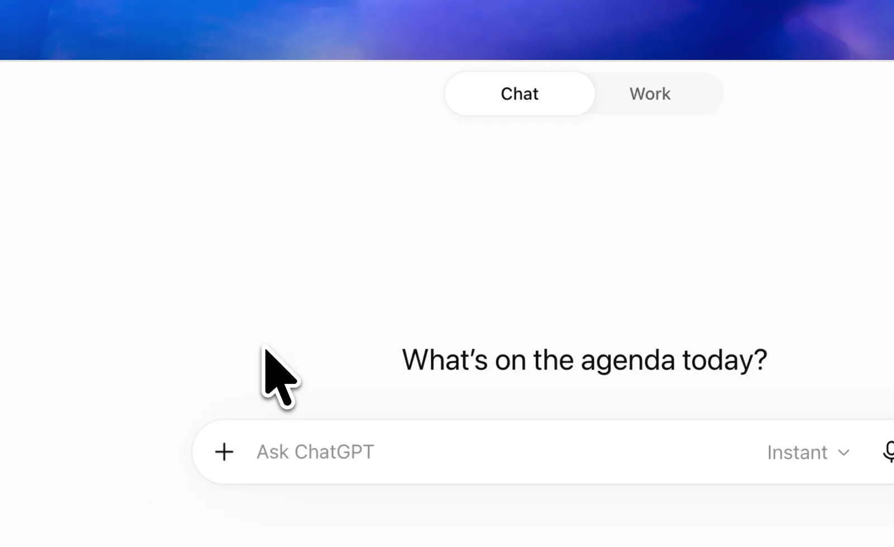

# モデルの設定：GPT-6 Sol・Mediumから始める

このキットでは、ChatGPTアプリの **Work** で **GPT-6 Sol（表示例：6 Sol）**、推論の深さを指定する **effortはMedium** をおすすめします。日々の優先順位やメールの整理で、速度と考える深さのバランスを取るための教材側の提案です。公式の既定値や、すべての用事で最適な設定という意味ではありません。

## 1. ChatGPTのWorkを開く

アプリで新しい会話を開き、**ChatGPT → Work** を選びます。GPT-6 SolはWorkで利用するモデルで、Chatでは選べません。[公式のモデル案内](https://learn.chatgpt.com/docs/models)・[アプリの操作手順](https://learn.chatgpt.com/docs/quickstart?setup=app)

画像は[OpenAI公式のWork導入ページ](https://learn.chatgpt.com/docs/get-started-with-work)の紹介動画に使われている入口画面です。GPT-6 SolやMediumを選択済みの画面ではありません。[画像の出典](https://learn.chatgpt.com/images/codex/video-posters/chatgpt-work-select.webp)

PCではWebガイドの起動ボタンも使えます。スマホやボタンで開かない場合はアプリアイコンから開いてください。表示や配置はアプリによって異なります。

## 2. GPT-6 SolとMediumを選ぶ

1. 会話の入力欄の下にある、モデルと推論の設定を開きます。
2. **Advanced** を開き、モデルを **GPT-6 Sol**、effortを **Medium** にします。同じ組み合わせのPower設定があれば、そこから選んでも構いません。
3. 入力欄の近くに **6 Sol** と **Medium** が表示されていることを確認します。
4. [はじめるための文](quickstart.md)を貼り付けて送信します。

[公式Modelsページの操作見本](https://learn.chatgpt.com/docs/models)でも、PowerとAdvancedの位置を確認できます。これは公式ページ内の操作見本であり、自分のアプリの設定を変更するものではありません。公式の見本には6 Sol Lightと6 Sol Mediumが登場しますが、初期値や選択肢は全員共通ではありません。

**このキットの文を送ったり、Webガイドのボタンを押したりするだけでは、モデルやeffortは変わりません。** 選択はChatGPTアプリ内で行います。会話の回答だけで設定できたと判断せず、モデルの表示を見てください。

## 3. 普段は同じ設定で使う

同じ会話ではMediumのまま使い、毎回設定を変える必要はありません。新しい会話ではモデルの表示を確かめてください。複数の締切が競合するなど、判断が難しいときに、必要ならHighを試します。推論の深さを上げると、時間や利用量が増える場合があります。この教材ではMaxやUltraは求めません。[公式のeffortの説明](https://learn.chatgpt.com/docs/models)

モデルを変えても、不明な締切や担当者の承諾が確定するわけではありません。資料にある内容と提案を見比べながら、同じ会話の表を更新します。

## 項目が見つからないとき

選べるモデルやeffortは、プラン、アプリ、組織の設定、提供時期によって異なります。次を順に確かめてください。

1. **ChatGPT → Work** になっているか。
2. 利用するアカウントや組織のワークスペースでログインしているか。
3. アプリの更新があるか。

それでも見つからなければ、今表示されているモデル名や設定名を確認します。相談するときは、個人情報を含む画面全体ではなく、その項目名だけを伝えれば構いません。GPT-6 Solが使えると決めつけたり、別のモデルを6 Solと呼んだりせず、手元で使える選択肢から案内を受けてください。これを理由に、課金や権限の拡張を急ぐ必要はありません。

モデル選択は、Google連携やアクセス権限の設定とは別です。メールやカレンダーを接続せずに始められます。接続したくなったときだけ、[連携の手順](setup-connections.md)を確認してください。

確認日：2026-10-22。画面や利用条件は変更されるため、実際のアプリの表示と[公式案内](https://learn.chatgpt.com/docs/models)を確認してください。
